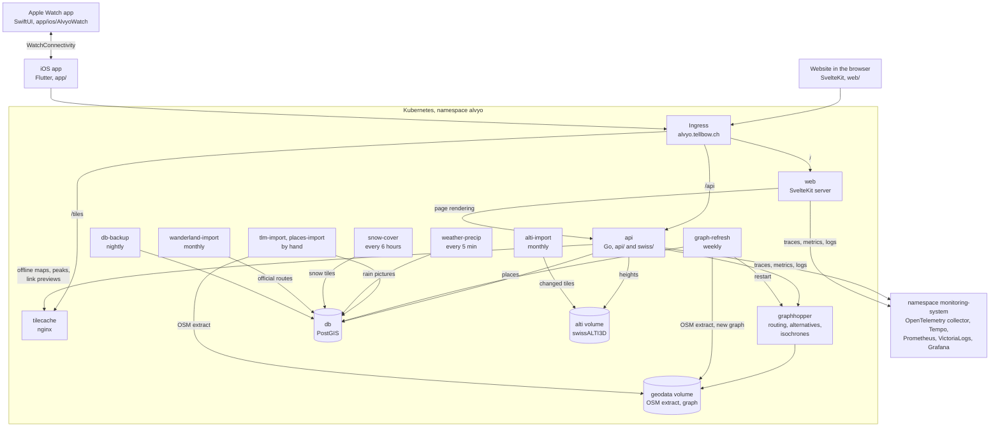
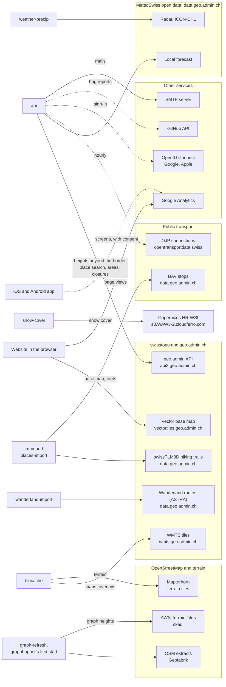
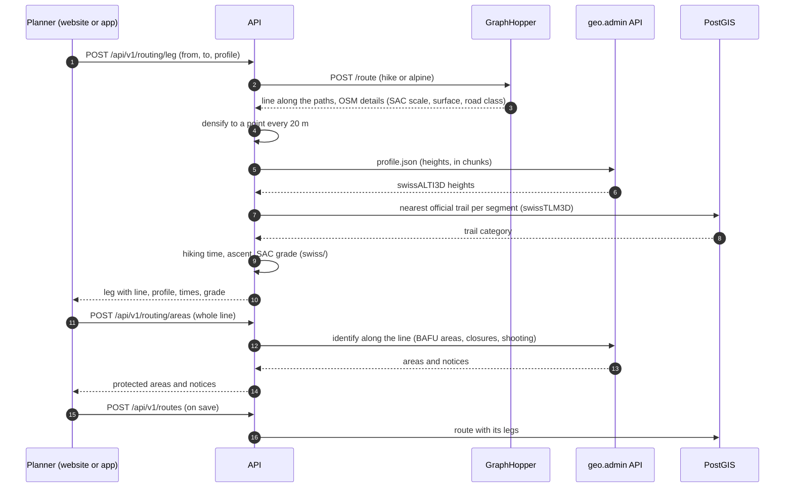

# Architecture

Alvyo is a website and an iOS app in front of one Go API. Everything of
ours runs in a Kubernetes cluster (namespace `alvyo`, deployed by Flux
from a private deployment repository); `infra/compose.prod.yaml` runs the same
parts on a single server. The maps, heights,
trails, weather and public transport come from Swiss open data, mostly
through geo.admin.ch.

## Overview

Both clients reach one address, `alvyo.tellbow.ch`. The ingress sends
`/api` to the API, `/tiles` to the tile cache and everything else to the
web server, so pages, API and tiles share one origin and one cookie. The calls to
outside services are in the next diagram.

What each part does, and why it is there:

- **AI assistants and `alvyo-cli`** read through the API's MCP endpoint
  (`/api/v1/mcp`) with a personal access token; its tools call the same
  code as the website's requests ([mcp.md](mcp.md)).
- **web** renders the pages (SvelteKit). On the server it asks the API
  through the cluster (`API_INTERNAL_URL`); in the browser the pages call
  `/api` directly.
- **api** holds all logic: accounts, routes, journeys, imports, weather,
  public transport. Hiking time, SAC grade and elevation sampling live in
  the `swiss/` module. It keeps photos on its own volume and offline map
  packs, peak packs and link preview images in a cache it can rebuild.
- **db** is PostgreSQL with PostGIS. Besides the users' data it holds the
  official trail network (to grade routes), stops, huts and other places,
  and the rain pictures. `db-backup` dumps it every night; the photo
  volume has Longhorn snapshots.
- **graphhopper** finds the way on OpenStreetMap paths: legs, alternatives,
  round trips and how far one gets in a few hours (isochrones). It serves
  the graph from the `geodata` volume.
- **tilecache** fetches every map tile from swisstopo and Mapterhorn once
  and keeps it for 30 days. swisstopo's terms allow restricting excessive
  use, so neither the browsers nor the app ask swisstopo for raster tiles
  themselves. Only the layers we use are let through.
- **graph-refresh** downloads the OSM extracts every Monday (Switzerland,
  Liechtenstein and 15 km beyond), builds a new graph next to the live one,
  restarts GraphHopper on it and loads the places anew. On import
  GraphHopper downloads AWS terrain tiles for the slopes of the isochrones.
- **tlm-import** and **places-import** are suspended CronJobs, started by
  hand: swisstopo's trail network once a year, BAV stops and huts from the
  OSM extract (places-import also runs at the end of every graph refresh).
- **alti-import** keeps swisstopo's height model swissALTI3D (2 m) as
  tiles on a volume the API reads ([ADR-0005](adr/0005-own-copy-of-swissalti3d.md));
  monthly, it fetches the tiles swisstopo renewed.
- **wanderland-import** loads the official routes of Wanderland Schweiz
  every month into tables of their own; the API makes public routes and
  journeys of them (`api/internal/official`).
- **weather-precip** turns MeteoSwiss's radar of the last hour and the
  ICON-CH1 forecast into pictures every five minutes, so the API only
  serves them from the database.
- **snow-cover** turns Copernicus's daily snow cover (60 m, the newest day
  with all tiles over Switzerland) into map tiles (zoom 6–11, only those
  with snow), looked for every six hours; the API serves them from the
  database.
- **monitoring-system** is the cluster's own namespace for it. The API
  and the web server send traces to the OpenTelemetry collector on their
  node, which passes them to Tempo; Tempo derives span metrics for
  Prometheus, which also scrapes the metrics of both. The collector puts
  the logs into VictoriaLogs. Grafana shows all three and links a trace to
  its log lines ([operations.md](operations.md#telemetry)).

## External APIs and data

Who calls which outside service. Dashed arrows are optional: they need a
token or a configured provider. The app calls none of them itself: it gets
maps, weather and peaks through the API and the tile cache.

In more detail:

| Service | Called by | For |
|---|---|---|
| `wmts.geo.admin.ch` | tile cache | National map (colour, grey), aerial images, and the overlays: hiking trails, SchweizMobil routes (ASTRA), slopes over 30°, relief, BAFU wildlife rest areas and hunting reserves |
| `vectortiles.geo.admin.ch` | browser | The vector base map «Basiskarte»: its style, tiles, sprites and fonts (website only, not through the tile cache; when they fail, the Landeskarte instead) |
| `api3.geo.admin.ch` | API | Heights of legs beyond the border, or all without our swissALTI3D tiles (profile service), place search, protected areas (BAFU) and current notices (ASTRA trail closures, VBS shooting) along a line (identify service) |
| `data.geo.admin.ch` | tlm-import, places-import, alti-import | swissTLM3D hiking trails, BAV stops, swissALTI3D (2 m tiles, monthly the changed ones) |
| `data.geo.admin.ch` (ASTRA) | wanderland-import | The official routes of Wanderland Schweiz, monthly |
| `s3.WAW3-2.cloudferro.com` (EEA, Copernicus) | snow-cover | The daily gap-filled snow cover (HR-WSI GFSC), EEA's public bucket, read without keys |
| `data.geo.admin.ch` (MeteoSwiss) | API, weather-precip | Local forecast (API, hourly), radar and ICON-CH1 (job). The climate normals are a file in the API, updated once a decade. |
| `api.opentransportdata.swiss` | API | Public transport connections (OJP), only with `ALVYO_OJP_TOKEN` |
| `download.geofabrik.de` | graph-refresh, graphhopper's first start | OSM extracts for the graph and the places |
| `tiles.mapterhorn.com` | tile cache | Terrain for the 3D map, the app's peak recognition and its peak pack |
| AWS Terrain Tiles (skadi) | GraphHopper import | Heights in the graph, for the isochrones' slopes |
| OpenID Connect providers | API, browser, app | Optional sign-in: Google, Apple (`ALVYO_OIDC_PROVIDERS`); Apple also in the iOS app, and Apple posts notifications to the API |
| `api.github.com` | API | Bug reports as issues, only with `ALVYO_GITHUB_TOKEN` |
| SMTP server | API | Confirmation, password and reminder mails |
| Google Analytics | browser, app | Page views on alvyo.tellbow.ch, cookies only after consent; in the app (Firebase) the kinds of screens opened, only after consent, without the advertising id |

## Planning a route

The planner asks for one leg at a time, between two points the user set.
The API does the work, so the website and the app plan the same way.

Heights come from swisstopo rather than from the graph: swissALTI3D has a
2 m grid, and with it the hiking times match the official SchweizMobil
figures ([hiking-time.md](hiking-time.md),
[ADR-0002](adr/0002-elevation-and-hiking-time.md)). The API keeps its own
copy ([ADR-0005](adr/0005-own-copy-of-swissalti3d.md)) and asks geo.admin
only beyond the border. The trail category
comes from the official network, not from OSM, because it decides the SAC
grade and whether a stretch counts as a hiking trail.
